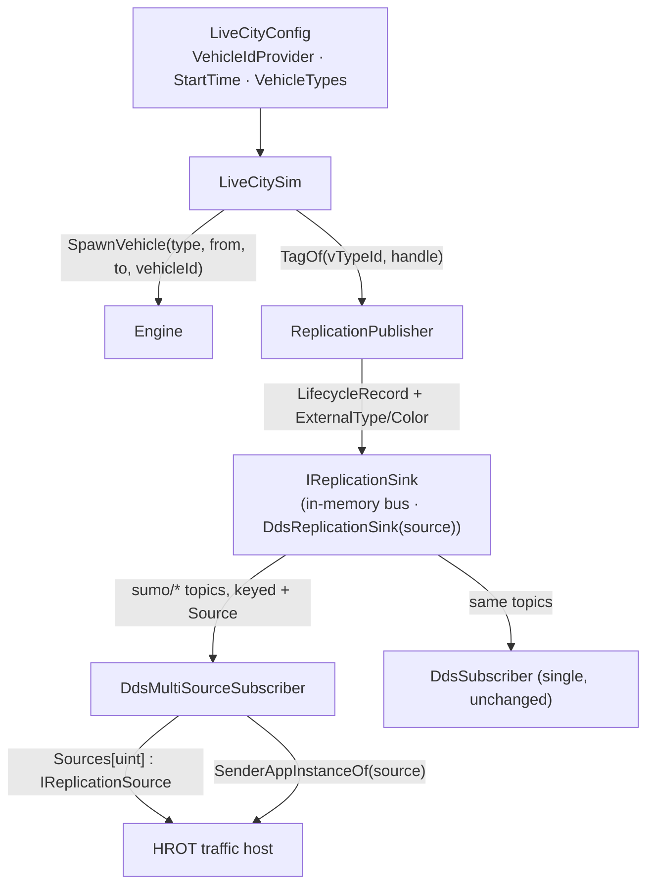

# HROT-INTEGRATION-DESIGN.md — the host seams HROT needs (design + tasks, folded)

> **Status:** LIVE, 2026-10-17. Branch `hrot/slice1`. Tracker: [`HROT-INTEGRATION-TRACKER.md`](HROT-INTEGRATION-TRACKER.md).
> **Why:** HROT (github.com/pjanec/HROT) embeds SumoSharp as a traffic module in its editor and, later, a dedicated traffic
> node. Every decision below was made and approved on the HROT side — its design of record is HROT's
> `docs/blueprints/Architect_Question_93_Sumo_Traffic_Node.md` (rulings R-4020…R-4052). This file is the SumoSharp half:
> the exact seams, and why each is parity-neutral. HROT vendors these sources read-only (AQ93 §11 V1–V3), so every change
> it needs lands HERE first.

## Parity argument (applies to every task)

Every change is **additive and default-off**: a new optional field, a new overload, a new constructor flag, or a new
library. No existing call site, default value or per-step code path changes ⇒ all goldens byte-identical, the bench hash
unchanged. Each task's success condition includes the full `dotnet test -c Release` (CLAUDE.md measurement rule 9).

## H1 — `<location>` is parsed *(AQ93 E1/E1b)*

`NetworkParser` ignored `<location>`; a host could not place a net in its own world. **Seam:** `NetworkModel.Location`
(`NetLocation? = null`, last record parameter) carrying `NetOffsetX/Y`, `ConvBoundary`, `OrigBoundary` (raw), `ProjParameter`
and `IsGeoreferenced` (`ProjParameter != "!"`). SumoSharp still never re-origins or reprojects
(`EXTERNAL-NET-VIEWER-DESIGN.md`); the host does. Absent element ⇒ null; a malformed number throws.
**Success:** a georeferenced net (`_ped/georef_min`) parses UTM zone 32 with its offset; `_ped/demo_city/box` parses `"!"`
with offset (−150, −150) and `IsGeoreferenced == false`; a hand-built model compiles unchanged; full suite green.

## H2 — `Sim.Scene`: road and signal geometry, out of the Godot demo *(AQ93 V7, R-4049)*

CityLib's builders are already Godot-free except ONE thing: every vertex goes through `CoordinateTransform.SumoToGodot`
(`RibbonMesh.Vertices` is "already in GODOT space"). **Seam:** a new packable library `src/Sim.Scene` (net8.0 +
netstandard2.1, bundled into the `SumoSharp` package like the other eight) that emits geometry in **SUMO's own frame**
(x east, y north, z up, metres, relative to a caller origin) with a **kind per triangle** — asphalt, junction, marking,
crosswalk, ambient ground — plus the signal-head list; and adds the one missing builder, **junction-polygon
triangulation** (`Junction.Shape`). CityLib's builders become thin wrappers that apply the Godot axis swap at the end, so
the City3D viewer and `CityLib.Tests` see identical numbers.
**Success:** `CityLib.Tests` green with no expected value changed (the wrappers are exact: the swap is a reorder and a
negation); new `Sim.Scene` tests for the frame (a known lane point maps to `(x − ox, y − oy, z − oz)`) and for junction
triangles covering the polygon's area; full suite green; the package packs.

## H3 — DDS samples can carry SIM time *(AQ93 E9, R-4027)*

`DdsSubscriber` stamps samples with the DDS SourceTimestamp (wall clock); a host whose clock is the sim clock (pausable,
scalable, seekable) resolves with `DrClock.ResolveAt` at sim time. **Seam:** `DdsSubscriber(participant, stampWithSimTime)`;
the old constructor keeps wall-clock stamps. (`InMemoryReplicationBus` already stamps with the frame's sim time.)
**Success:** a loopback test: with the flag, the history's sample times equal the frames' sim times; without, unchanged.

## H4 — the host may choose a vehicle's id *(AQ93 E11, R-4029/R-4038)*

The id `SpawnVehicle` generates (`__vehN`) is what `VehicleIds` and `LifecycleRecord.Name` carry; HROT keys a car to its
own network id. **Seam:** `SpawnVehicle(type, routeEdges, string? vehicleId, …)`; null = the generated id (the old overload
forwards with null); a duplicate of a live (Pending/Active) vehicle's id throws.
**Success:** a spawned vehicle with id `"4711"` reports `"4711"` in `VehicleIds` and on its lifecycle record; spawning a
second live `"4711"` throws; after it arrives the id may be reused; full suite green.

## H5–H8 (networked traffic node) — and H9 *(slice 2, branch `hrot/slice2`)*

HROT runs the live-city host as a **networked traffic node**: one or more `LiveCitySim`s, each publishing cars over DDS,
keyed to HROT entity ids, stamped in cluster sim time, with a per-car HROT entity type and colour. Same parity argument
as above: every seam is a new optional field / overload / class; every default reproduces today's bytes.

*What the picture shows that prose hid:* the per-source split happens only at the multi-source READER; the
sink stays one per publisher, and the existing single `DdsSubscriber` still reads the same topics, unfiltered.

### H5 — host-chosen vehicle ids in the live-city host *(AQ93 E11)*

`LiveCityConfig.VehicleIdProvider : Func<string>?` (null = today). When set, each car spawn calls it once and passes the
id to a new `Engine.SpawnVehicle(VTypeHandle, string fromEdge, string toEdge, string? vehicleId, departPos, departSpeed,
departLane, departBestLane)` that routes and forwards to H4's edge-list overload (the old from/to overload forwards with
null ⇒ byte-identical). H4's live-duplicate guard throws `ArgumentException`; `LiveCitySim` catches it like the existing
unroutable `InvalidOperationException`, so a provider that repeats a live id skips that spawn and the step goes on. The
provider is called only after a route pair is drawn (from ≠ to) and before the spawn; an id consumed by a spawn that then
fails is simply lost (ids are cheap; never reused by us). The RNG draw sequence is untouched ⇒ the default path is the same.

### H6 — the live-city clock may start at a host time *(AQ93 E9)*

`LiveCityConfig.StartTime : double = 0`. `LiveCitySim` writes it as the engine config's `<begin>` (formatted `"R"`,
invariant) and seeds `_now` from it, so `Time`, `Engine.CurrentTime`, every snapshot time and therefore every published
frame/TL sample time is `StartTime + elapsed`. Default 0 writes the identical `<begin value="0"/>` string.

### H7 — an external type and colour on the spawn record *(AQ93 E11)*

`LifecycleRecord` gains `long ExternalType` and `uint Color` (0xRRGGBB, 0 = none) through a NEW 8-argument constructor;
the existing 6-argument one keeps zeros. Populated on SPAWN only (a despawn carries zeros, like `Name`).
`IReplicationSource.Tags : IReadOnlyDictionary<VehicleHandle, VehicleTag>` (`VehicleTag { long ExternalType; uint Color }`)
mirrors `Names`: set on spawn, removed on despawn — but only for a NON-ZERO tag, so the default path stores nothing
(absent ⇒ `(0, 0)`). Implemented by all three sources (in-memory bus, `DdsSubscriber`, `ReplicationFileSource`, which
inherits its bus's — `.simrec` does not record tags). `DdsVehicleLifecycle` gains `ExternalType` (DdsId 7) and `Color`
(DdsId 8), appended. The value comes from `ReplicationPublisher.TagOf : Func<string, VehicleHandle, (long ExternalType,
uint Color)>?` (null = zeros), called with the snapshot's vType id (the `VType.Id` the engine reports — `vTypeId` on the
wire stays 0 as today, there is still no numeric vType registry) at the vehicle's first announcement.

### H8 — several publishers on one bus: a source key + per-sender demux *(AQ93 E10)*

**Problem.** Every SUMO topic instance is keyed per publisher-local value (lifecycle by vehicle `Index`, frames by
`(Kind, ChunkIndex)`, geometry and TL by `ChunkIndex`), so two publishers on one domain write the SAME instances:
durable "latest" lifecycle lets B's car #5 replace A's car #5 for late joiners, and B's geometry chunk 0 replaces A's.

**Seam 1 — the key.** Every SUMO vehicle-side topic struct gains `[DdsKey, DdsId(N)] public uint Source` appended as its
last member (`DdsWireFrame` 6, `DdsVehicleLifecycle` 9, `DdsNetworkGeometry` 6, `DdsTlState` 5) — the same attribute
pattern `DdsWireFrame` already uses for its two-field key; the generator emits it as a further `@key` member.
`DdsReplicationSink(participant, uint source)` stamps it on every sample; the old constructor is `source: 0`.
⚠ The wire TYPE changes (a new key member), so every peer on a domain must run this version — expected, HROT vendors
both ends. `DdsWireFrame` is shared with the ped crowd topic, whose sink leaves `Source = 0`.

**Seam 2 — the demux reader.** `DdsMultiSourceSubscriber(participant, stampWithSimTime = false, sourceTimeoutSeconds = 0)`
reads the same four topics with the same QoS and routes every sample by `Source` into a per-source state that implements
`IReplicationSource` (own geometry, histories, dims, names, tags, TL table). `Sources : IReadOnlyDictionary<uint,
IReplicationSource>`; one `Pump()` drains all four readers (a per-source `Pump()` forwards to it). A source APPEARS on its
first valid sample and DISAPPEARS when (a) an instance of it reports `NotAliveNoWriters`/`NotAliveDisposed` (its sink's
writers are gone — instances are keyed by `Source`, one writer per topic per source, so this is that publisher), or
(b) `sourceTimeoutSeconds > 0` and nothing arrived from it for that long (off by default: an empty sim publishes no frames,
and a re-appearing source would not get its durable geometry back). `SourcesAppeared`/`SourcesRemoved` counters aid tests.

**Seam 3 — the sender.** When the participant has sender tracking (`participant.SenderRegistry != null`, enabled by the
host via `EnableSenderTracking`), every reader calls `EnableSenderTracking(registry)`; per source the subscriber records
`loan.GetSender(i)?.AppInstanceId` and the sample's `PublicationHandle`. `int? SenderAppInstanceOf(uint source)` returns
it, retrying `SenderRegistry.TryGetIdentity(publicationHandle)` while unresolved (CycloneDDS.NET 0.3.2 moves an arrived
identity into its lookup from an async loop — HROT's CE-517 note), null when tracking is off or not yet resolved. The
host uses that sender as the cars' OWNER; `Source` only keeps instances apart.

**Reuse, not copy.** The decode logic moves from `DdsSubscriber` into an internal `DdsReplicationState` (the four
`Apply*` methods + the dictionaries + the `IReplicationSource` surface). `DdsSubscriber` owns ONE state and feeds it every
sample unfiltered (exactly today: source 0 or not); the multi-source reader owns one per `Source`. H3's
`stampWithSimTime` lives in the state, so both readers honour it the same way.

### H9 — a weighted vehicle-type mix in the live-city host

`LiveCityConfig.VehicleTypes : IReadOnlyList<LiveCityVehicleType>?` (null = today's single passenger type), each
`{ Id, VClass, Length, Width, MaxSpeed?, Weight, ExternalType, Color }`. `LiveCitySim` defines each as an engine vType
(`DefineVType(new VTypeParams { VClass, Length, Width, MaxSpeed, Sigma = 0 }, id: Id)`) and, per spawn, picks one by
cumulative weight with ONE extra `NextRng()` draw — only when the list is set, so the default draw sequence is untouched.
Width did not reach the dims: `VTypeParams`/`VType` had no width (it came from the vClass table only), so both gain an
optional `Width` (null ⇒ the vClass default, i.e. unchanged) that `VTypeDefaults.Resolve` honours; the rou.xml parser is
NOT changed (no golden can see it). `LiveCitySim` sets `TagOf` on its live and record publishers to look the vType id
up in the table ⇒ H7's `ExternalType`/`Color`. A failed spawn of a picked type behaves exactly as today (skipped).

**Success (all of H5–H9):** the rails in `tests/Sim.ParityTests/HrotIntegrationSeamTests.cs` (engine), 
`tests/Sim.LiveCity.Tests/HrotLiveCitySeamTests.cs` (H5/H6/H9 + H7 via the in-memory bus), `tests/Sim.Host.Tests`
(H7 publisher hook) and the new `tests/Sim.Replication.Dds.Tests` (H3 rail, H7 over DDS, H8 two sources + sender
tracking, domains 221–229); full `dotnet test Traffic.sln -c Release` green with every golden unchanged.
