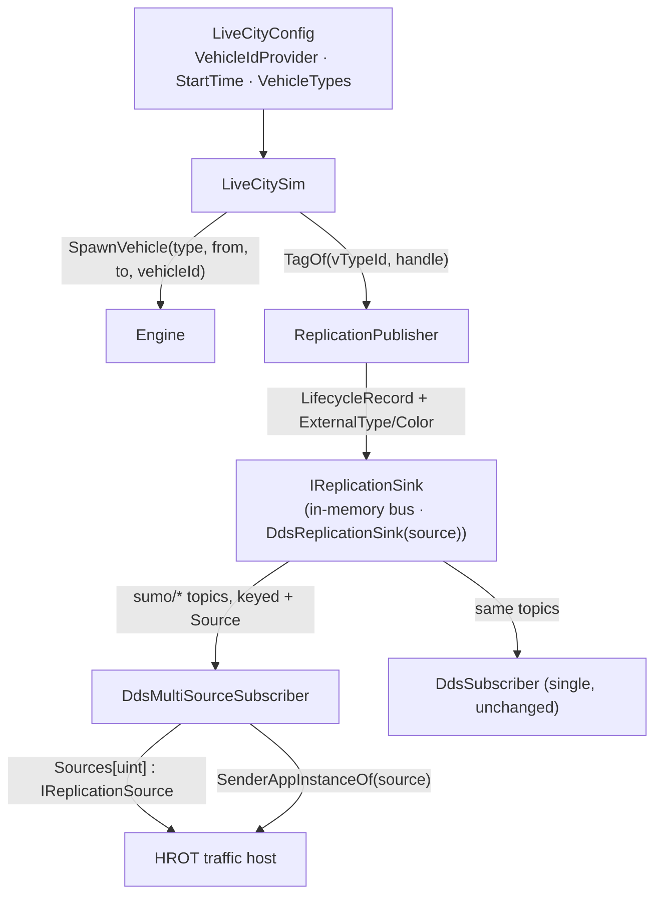
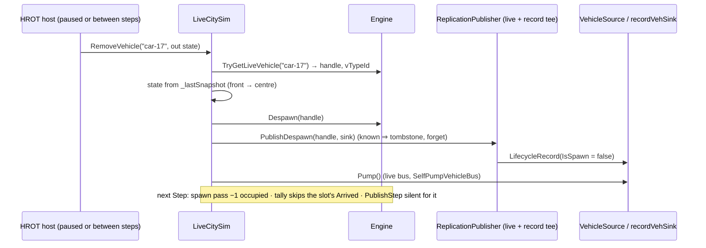

# HROT-INTEGRATION-DESIGN.md — the host seams HROT needs (design + tasks, folded)

> **Status:** LIVE, 2026-10-17. Branch `hrot/slice1`. Tracker: [`HROT-INTEGRATION-TRACKER.md`](HROT-INTEGRATION-TRACKER.md).
> **Why:** HROT (github.com/pjanec/HROT) embeds SumoSharp as a traffic module in its editor and, later, a dedicated traffic
> node. Every decision below was made and approved on the HROT side — its design of record is HROT's
> `docs/blueprints/Architect_Question_93_Sumo_Traffic_Node.md` (rulings R-4020…R-4052). This file is the SumoSharp half:
> the exact seams, and why each is parity-neutral. HROT vendors these sources read-only (AQ93 §11 V1–V3), so every change
> it needs lands HERE first.

## Parity argument (applies to every task)

Every change is **additive and default-off**: a new optional field, a new overload, a new constructor flag, or a new
library. No existing call site, default value or per-step code path changes ⇒ all goldens byte-identical, the bench hash
unchanged. Each task's success condition includes the full `dotnet test -c Release` (CLAUDE.md measurement rule 9).

## H1 — `<location>` is parsed *(AQ93 E1/E1b)*

`NetworkParser` ignored `<location>`; a host could not place a net in its own world. **Seam:** `NetworkModel.Location`
(`NetLocation? = null`, last record parameter) carrying `NetOffsetX/Y`, `ConvBoundary`, `OrigBoundary` (raw), `ProjParameter`
and `IsGeoreferenced` (`ProjParameter != "!"`). SumoSharp still never re-origins or reprojects
(`EXTERNAL-NET-VIEWER-DESIGN.md`); the host does. Absent element ⇒ null; a malformed number throws.
**Success:** a georeferenced net (`_ped/georef_min`) parses UTM zone 32 with its offset; `_ped/demo_city/box` parses `"!"`
with offset (−150, −150) and `IsGeoreferenced == false`; a hand-built model compiles unchanged; full suite green.

## H2 — `Sim.Scene`: road and signal geometry, out of the Godot demo *(AQ93 V7, R-4049)*

CityLib's builders are already Godot-free except ONE thing: every vertex goes through `CoordinateTransform.SumoToGodot`
(`RibbonMesh.Vertices` is "already in GODOT space"). **Seam:** a new packable library `src/Sim.Scene` (net8.0 +
netstandard2.1, bundled into the `SumoSharp` package like the other eight) that emits geometry in **SUMO's own frame**
(x east, y north, z up, metres, relative to a caller origin) with a **kind per triangle** — asphalt, junction, marking,
crosswalk, ambient ground — plus the signal-head list; and adds the one missing builder, **junction-polygon
triangulation** (`Junction.Shape`). CityLib's builders become thin wrappers that apply the Godot axis swap at the end, so
the City3D viewer and `CityLib.Tests` see identical numbers.
**Success:** `CityLib.Tests` green with no expected value changed (the wrappers are exact: the swap is a reorder and a
negation); new `Sim.Scene` tests for the frame (a known lane point maps to `(x − ox, y − oy, z − oz)`) and for junction
triangles covering the polygon's area; full suite green; the package packs.

## H3 — DDS samples can carry SIM time *(AQ93 E9, R-4027)*

`DdsSubscriber` stamps samples with the DDS SourceTimestamp (wall clock); a host whose clock is the sim clock (pausable,
scalable, seekable) resolves with `DrClock.ResolveAt` at sim time. **Seam:** `DdsSubscriber(participant, stampWithSimTime)`;
the old constructor keeps wall-clock stamps. (`InMemoryReplicationBus` already stamps with the frame's sim time.)
**Success:** a loopback test: with the flag, the history's sample times equal the frames' sim times; without, unchanged.

## H4 — the host may choose a vehicle's id *(AQ93 E11, R-4029/R-4038)*

The id `SpawnVehicle` generates (`__vehN`) is what `VehicleIds` and `LifecycleRecord.Name` carry; HROT keys a car to its
own network id. **Seam:** `SpawnVehicle(type, routeEdges, string? vehicleId, …)`; null = the generated id (the old overload
forwards with null); a duplicate of a live (Pending/Active) vehicle's id throws.
**Success:** a spawned vehicle with id `"4711"` reports `"4711"` in `VehicleIds` and on its lifecycle record; spawning a
second live `"4711"` throws; after it arrives the id may be reused; full suite green.

## H5–H8 (networked traffic node) — and H9 *(slice 2, branch `hrot/slice2`)*

HROT runs the live-city host as a **networked traffic node**: one or more `LiveCitySim`s, each publishing cars over DDS,
keyed to HROT entity ids, stamped in cluster sim time, with a per-car HROT entity type and colour. Same parity argument
as above: every seam is a new optional field / overload / class; every default reproduces today's bytes.

*What the picture shows that prose hid:* the per-source split happens only at the multi-source READER; the
sink stays one per publisher, and the existing single `DdsSubscriber` still reads the same topics, unfiltered.

### H5 — host-chosen vehicle ids in the live-city host *(AQ93 E11)*

`LiveCityConfig.VehicleIdProvider : Func<string>?` (null = today). When set, each car spawn calls it once and passes the
id to a new `Engine.SpawnVehicle(VTypeHandle, string fromEdge, string toEdge, string? vehicleId, departPos, departSpeed,
departLane, departBestLane)` that routes and forwards to H4's edge-list overload (the old from/to overload forwards with
null ⇒ byte-identical). H4's live-duplicate guard throws `ArgumentException`; `LiveCitySim` catches it like the existing
unroutable `InvalidOperationException`, so a provider that repeats a live id skips that spawn and the step goes on. The
provider is called only after a route pair is drawn (from ≠ to) and before the spawn; an id consumed by a spawn that then
fails is simply lost (ids are cheap; never reused by us). The RNG draw sequence is untouched ⇒ the default path is the same.

### H6 — the live-city clock may start at a host time *(AQ93 E9)*

`LiveCityConfig.StartTime : double = 0`. `LiveCitySim` writes it as the engine config's `<begin>` (formatted `"R"`,
invariant) and seeds `_now` from it, so `Time`, `Engine.CurrentTime`, every snapshot time and therefore every published
frame/TL sample time is `StartTime + elapsed`. Default 0 writes the identical `<begin value="0"/>` string.

### H7 — an external type and colour on the spawn record *(AQ93 E11)*

`LifecycleRecord` gains `long ExternalType` and `uint Color` (0xRRGGBB, 0 = none) through a NEW 8-argument constructor;
the existing 6-argument one keeps zeros. Populated on SPAWN only (a despawn carries zeros, like `Name`).
`IReplicationSource.Tags : IReadOnlyDictionary<VehicleHandle, VehicleTag>` (`VehicleTag { long ExternalType; uint Color }`)
mirrors `Names`: set on spawn, removed on despawn — but only for a NON-ZERO tag, so the default path stores nothing
(absent ⇒ `(0, 0)`). Implemented by all three sources (in-memory bus, `DdsSubscriber`, `ReplicationFileSource`, which
inherits its bus's — `.simrec` does not record tags). `DdsVehicleLifecycle` gains `ExternalType` (DdsId 7) and `Color`
(DdsId 8), appended. The value comes from `ReplicationPublisher.TagOf : Func<string, VehicleHandle, (long ExternalType,
uint Color)>?` (null = zeros), called with the snapshot's vType id (the `VType.Id` the engine reports — `vTypeId` on the
wire stays 0 as today, there is still no numeric vType registry) at the vehicle's first announcement.

### H8 — several publishers on one bus: a source key + per-sender demux *(AQ93 E10)*

**Problem.** Every SUMO topic instance is keyed per publisher-local value (lifecycle by vehicle `Index`, frames by
`(Kind, ChunkIndex)`, geometry and TL by `ChunkIndex`), so two publishers on one domain write the SAME instances:
durable "latest" lifecycle lets B's car #5 replace A's car #5 for late joiners, and B's geometry chunk 0 replaces A's.

**Seam 1 — the key.** Every SUMO vehicle-side topic struct gains `[DdsKey, DdsId(N)] public uint Source` appended as its
last member (`DdsWireFrame` 6, `DdsVehicleLifecycle` 9, `DdsNetworkGeometry` 6, `DdsTlState` 5) — the same attribute
pattern `DdsWireFrame` already uses for its two-field key; the generator emits it as a further `@key` member.
`DdsReplicationSink(participant, uint source)` stamps it on every sample; the old constructor is `source: 0`.
⚠ The wire TYPE changes (a new key member), so every peer on a domain must run this version — expected, HROT vendors
both ends. `DdsWireFrame` is shared with the ped crowd topic, whose sink leaves `Source = 0`.

**Seam 2 — the demux reader.** `DdsMultiSourceSubscriber(participant, stampWithSimTime = false, sourceTimeoutSeconds = 0)`
reads the same four topics with the same QoS and routes every sample by `Source` into a per-source state that implements
`IReplicationSource` (own geometry, histories, dims, names, tags, TL table). `Sources : IReadOnlyDictionary<uint,
IReplicationSource>`; one `Pump()` drains all four readers (a per-source `Pump()` forwards to it). A source APPEARS on its
first valid sample and DISAPPEARS when (a) an instance of it reports `NotAliveNoWriters`/`NotAliveDisposed` (its sink's
writers are gone — instances are keyed by `Source`, one writer per topic per source, so this is that publisher), or
(b) `sourceTimeoutSeconds > 0` and nothing arrived from it for that long (off by default: an empty sim publishes no frames,
and a re-appearing source would not get its durable geometry back). `SourcesAppeared`/`SourcesRemoved` counters aid tests.

**Seam 3 — the sender.** When the participant has sender tracking (`participant.SenderRegistry != null`, enabled by the
host via `EnableSenderTracking`), every reader calls `EnableSenderTracking(registry)`; per source the subscriber records
`loan.GetSender(i)?.AppInstanceId` and the sample's `PublicationHandle`. `int? SenderAppInstanceOf(uint source)` returns
it, retrying `SenderRegistry.TryGetIdentity(publicationHandle)` while unresolved (CycloneDDS.NET 0.3.2 moves an arrived
identity into its lookup from an async loop — HROT's CE-517 note), null when tracking is off or not yet resolved. The
host uses that sender as the cars' OWNER; `Source` only keeps instances apart.

**Reuse, not copy.** The decode logic moves from `DdsSubscriber` into an internal `DdsReplicationState` (the four
`Apply*` methods + the dictionaries + the `IReplicationSource` surface). `DdsSubscriber` owns ONE state and feeds it every
sample unfiltered (exactly today: source 0 or not); the multi-source reader owns one per `Source`. H3's
`stampWithSimTime` lives in the state, so both readers honour it the same way.

### H9 — a weighted vehicle-type mix in the live-city host

`LiveCityConfig.VehicleTypes : IReadOnlyList<LiveCityVehicleType>?` (null = today's single passenger type), each
`{ Id, VClass, Length, Width, MaxSpeed?, Weight, ExternalType, Color }`. `LiveCitySim` defines each as an engine vType
(`DefineVType(new VTypeParams { VClass, Length, Width, MaxSpeed, Sigma = 0 }, id: Id)`) and, per spawn, picks one by
cumulative weight with ONE extra `NextRng()` draw — only when the list is set, so the default draw sequence is untouched.
Width did not reach the dims: `VTypeParams`/`VType` had no width (it came from the vClass table only), so both gain an
optional `Width` (null ⇒ the vClass default, i.e. unchanged) that `VTypeDefaults.Resolve` honours; the rou.xml parser is
NOT changed (no golden can see it). `LiveCitySim` sets `TagOf` on its live and record publishers to look the vType id
up in the table ⇒ H7's `ExternalType`/`Color`. A failed spawn of a picked type behaves exactly as today (skipped).

**Success (all of H5–H9):** the rails in `tests/Sim.ParityTests/HrotIntegrationSeamTests.cs` (engine), 
`tests/Sim.LiveCity.Tests/HrotLiveCitySeamTests.cs` (H5/H6/H9 + H7 via the in-memory bus), `tests/Sim.Host.Tests`
(H7 publisher hook) and the new `tests/Sim.Replication.Dds.Tests` (H3 rail, H7 over DDS, H8 two sources + sender
tracking, domains 221–229); full `dotnet test Traffic.sln -c Release` green with every golden unchanged.

## H10 — a burst of sparse vehicle frames reaches every reader *(HROT CE-4017)*

📌 Measured on HROT's five-process cluster: each node posed the same SUMO car differently, one node at a time freezing a car for
5–10 s and then jumping. The Vehicles topic is SPARSE (`PublishPolicy`: a car only when it diverges or its 3 s heartbeat fires) and
every step writes ONE instance (chunk 0); with `VolatileLatest()` = KEEP_LAST(1) a reader that pumps once after a catch-up (HROT
steps up to 40 per call) keeps only the last frame, so the earlier frames' cars lose their update and `DrClock`'s 3 s extrapolation
cap freezes them. ⇒ the vehicle writer and readers use `VolatileLatest(DdsQos.SparseStreamDepth)` (64). Additive for a single
reader that keeps up (it already took every frame); the Tl topic stays at depth 1 (each frame is the whole table).
⚠ Not fixed here: a best-effort sample LOST on the network is still not repaired until the car's next fire — with the heartbeat
equal to the 3 s extrapolation cap, one lost heartbeat of a steady car still freezes it until the next.

## H11 — every topic is named on its type, so generic DDS tools see the SUMO wire *(HROT request, 2026-10-17)*

🔒 HROT: *"lets make them implicit then"* — `ddsmonitor` (CycloneDDS.NET's sniffer) discovers a topic by its type's `[DdsTopic]` name and
`[DdsQos]`, and the SUMO types carried a BARE `[DdsTopic]` with the name passed to every writer/reader instead, so the sniffer never
saw them. ⇒ each type now names its topic (`sumo/vehicles`, … — the wire names are UNCHANGED, so `DdsTopicNames` keeps its values and a
rail pins each to its type) and declares the QoS its endpoints used (`DdsQos.VolatileLatest`/`DurableLatest` profiles, the vehicle stream
at H10's depth), and every endpoint uses the 1-arg ctor. ⚠ One type carries ONE name: `DdsWireFrame` served `sumo/vehicles` AND
`sumo/ped-crowd`, `DdsPedLeg` served `sumo/ped-patharc` AND `sumo/ped-activity` ⇒ `DdsPedCrowdFrame` and `DdsPedActivityLeg` (same layout
and keys) take the second topic of each; their payload copy is `DdsWire.CopyIn/CopyOut`, not a repeated block. ⛔ The old note
"the [DdsTopic] attribute does NOT carry a usable name" was about a bare attribute; it is superseded.

## H12 — the host's own moving bodies are obstacles and discs the cars react to *(HROT request, 2026-10-17)*

HROT moves its own vehicles and soldiers through the same streets; SUMO's cars drove through them. **Seam:**
`LiveCitySim.SetExternalBodies(ReadOnlySpan<ExternalBody>)` (stepping thread, between `Step()`s; each call REPLACES the
set, diffed by `Id`) over `Sim.Core.Bridge.ExternalBodyFeed`, which maps each `ExternalBody(Id, Kind, X, Y, Vx, Vy, Length, Width)`
(net frame, centre, m/s) onto the two shapes the engine already has:

| body | becomes | rule |
|---|---|---|
| `Vehicle` overlapping ≥1 vehicle lane | `Engine.AddMovingObstacle` per overlapped lane, then `UpdateObstacle` in place, `RemoveObstacle` when it leaves that lane | footprint taken lane-aligned (no heading on the record): `\|lat\| < lane.Width/2 + Width/2` and the along-axis overshoot past the lane's ends `< Length/2`; `frontPos = clamp(offset + Length/2, 0, lane.Length)`, `speed = max(0, v·dir)`, `latPos = lat`, `latSpeed = v·leftNormal`, `width = Width`, `maxDecel = 7.5` |
| `Vehicle` overlapping no lane | radius-`Width/2` disc chain along its velocity (else the nearest lane's direction; neither ⇒ one radius-`max(L,W)/2` disc) | — |
| `Person` | one disc, radius `max(L,W)/2` (0.3 m if both ≤ 0) | — |

Discs reach the cars through `ICrowdFootprintSource.QueryNear` (nearest-first via `WorldDiscQuery.InsertNearest`): while the feed
holds a disc, `Engine.CrowdSource` = `CompositeFootprintSource(own, feed)` — or the feed alone when peds are disabled (HROT's
`PedPopulationCap = 0` left it null) — and it reverts to the ctor's own source when the feed holds none. Lanes are found with
`Sim.Ingest.LaneSpatialIndex` (a uniform segment grid, SumoRouteGraphNav's B1 construction, cell floor 10 m). When peds are enabled,
every body (on-road vehicles too) is also handed to the pedestrian crowd as `PedLodManager.Step`'s `externalEntities` (previously
always empty). ⚠ The lean's "no lane centre within 3 m + half a lane width ⇒ disc" test is subsumed: a vehicle overlapping no lane
is a disc at any distance. ⚠ Limits: `ObstacleConstraint` reads the car's CURRENT lane only, so a body just past a junction is seen
when the car enters that lane (discs, projected onto the current lane, are seen earlier); a footprint/kind change re-adds the obstacles.
**Inert:** never calling it creates no feed and leaves `CrowdSource` and the ped input as before. **Success:** rails `H12_…` in
`tests/Sim.LiveCity.Tests/HrotExternalBodyTests.cs` (a parked vehicle body stops the queue and its removal releases it; a person
disc stops cars with peds disabled; straddle ⇒ both lanes, leave ⇒ removed, off-road ⇒ disc; QueryNear nearest-first;
`LaneSpatialIndex` equals a brute-force `LaneProjection` scan on `_ped/demo_city/box`); full suite green.

## H13 — hand one of HROT's vehicles to SUMO as a shadow car, and take it back *(HROT AQ93 §14, R-4023)*

HROT keeps owning the vehicle; SUMO drives a SHADOW named by HROT (`hrot:<networkId>`) and HROT's body follows the shadow's pose
from the normal vehicle wire. **Seam** (`LiveCitySim`):
`bool SpawnExternalVehicle(string id, double x, double y, double heading, double speed, double destX, double destY, string? vTypeId = null)`,
`bool DespawnExternalVehicle(string id)`, `bool ExternalVehicleArrived(string id)`, `bool IsExternalVehicleLive(string id)`,
`int ExternalVehicleCount`, `const ExternalVehicleSnapRadius = 10`.

| step | rule |
|---|---|
| start | (x, y) = the FRONT bumper (SUMO's position, the point the wire reports back); `heading` radians, 0 = +x, CCW (`atan2(vy, vx)`). The nearest vehicle lane (not `:`-internal) within 10 m whose direction at the projection is < 90° off ⇒ `departLane` = its index, `departPos` = the projected offset, `departSpeed` = clamp(speed, 0, lane speed) |
| destination | the nearest vehicle lane within 10 m of (destX, destY) ⇒ its edge, and **`arrivalPos` = the projected offset** — new `VehicleDef.ArrivalPos` (null = edge end, every parsed vehicle) + `Engine.SpawnVehicle(…, departBestLane, double? arrivalPos)`; the final-edge arrival test is SUMO's `pos >= arrivalPos`, lane-agnostic, so no arrivalLane |
| route | `Engine.SpawnVehicle(type, fromEdge, toEdge, id, …)` (H5's router + H4's live-id guard) |
| false | no start lane, no destination lane, destination behind the start on one edge, no route, unknown `vTypeId`, live id — never throws |
| wire | a normal car: spawn `LifecycleRecord` (IsSpawn, Name = id) on its first snapshot; arrival AND `DespawnExternalVehicle` (`Engine.Despawn`) both drop it off the next snapshot ⇒ the same `IsSpawn = false` tombstone for that handle — a reader cannot (and need not) tell them apart; `ExternalVehicleArrived` does |
| demand | shadows are subtracted from the occupancy count, their arrivals are not in `ArrivedTotal`, `VehicleIdProvider` is never called |

📌 Measured: the shadow's last reported front position was **2.5 m** short of the destination (it leaves the sim the step it passes
`arrivalPos`, so the gap is at most one step of travel, `speed × Dt` — ~7 m at 13.9 m/s and Dt 0.5). ⚠ Arrival does not brake: SUMO's
default `arrivalSpeed` is "current", so the shadow passes the point at speed. ⚠ `EngineSnapshot` save/restore does not carry `ArrivalPos`.
**Inert:** `ArrivalPos` null ⇒ the added arrival term is false and tripinfo's arrivalPos stays the lane length; no shadow ⇒ demand's count
and tally unchanged. **Success:** rails `H13_…` in `tests/Sim.LiveCity.Tests/HrotExternalVehicleTests.cs` (three edges driven, arrival
within 7.5 m of the point and not at the edge end, spawn + tombstone records; heading/lane/route/type/id rejections; despawn mid-route ⇒
tombstone, id reusable; twin run with and without a disconnected shadow ⇒ demand identical step for step); full suite green.

## H14 — pedestrians on the HROT wire *(HROT AQ93 §8.3/§8.4 S1, S2, S5 — R-4031; §8.6 dropped promotion zones, so no S3/S4)*

HROT names SUMO's peds with its own network ids, removes one when it takes it over, and reads every publisher's peds by
name at its own sim time. **Seams:**

| item | seam |
|---|---|
| names | `LiveCityConfig.PedIdProvider` (`Func<string>?`) → `PedDemandConfig.IdProvider`: called once per ped that WILL spawn (an unroutable O/D draw consumes none); "" or a live name skips that spawn (H5's rule). The name rides the ped's **Spawn** `PedLifecycleRecord.Name` (new 4-arg ctor; in-memory bus + `DdsPedLifecycle.Name`, `FixedString64`). `PedLifecycleOnWire` / `AnnounceLifecycle` publish the lifecycle without names (names = id digits) |
| S1 remove | `LiveCitySim.RemovePedestrian(string name, out PedRemovalState state)` → `PedDemand.RemovePed(int id, double now, out PedRemovalState)`: drops the ped from the live set, the LOD manager and the name maps (so the next `Step` neither queries nor arrives it — the old `PedLodManager.RemovePed`-under-`PedDemand` crash), and returns `PedRemovalState(X, Y, Z, Vx, Vy, Heading)`; velocity = the crowd's (high-power) or a ±0.05 s central difference of the same pure position function (low-power); heading radians, 0 = +x, CCW (H13's convention), the next second's direction when standing. The freed slot is refilled by the ordinary spawn schedule (deterministic for a fixed call sequence). Its Despawn is forwarded to the wire immediately (a paused host steps nothing) |
| S2 despawn | new `PedSpawnedRecord` / `PedDespawnedRecord` events (`PedPublisher.PublishSpawned/PublishDespawned`); `PedDemand` emits a Despawn on ARRIVAL and on removal; `PedReplicationPublisher` maps them to `PedLifecycleKind.Spawn/Despawn`; `PedReplicationReceiver` + `HeadlessIg.Forget` drop the ped, `PedRemoteReconstructor` drops it and its name. `DdsPedReplicationSink` additionally **disposes** the despawned ped's PathArc/activity/lifecycle instances (the ones it wrote) so late joiners never get a gone ped and TRANSIENT_LOCAL history stays bounded |
| S5 sim time | the ped wire is sim-time throughout (crowd step time, leg start, lifecycle time — no DDS SourceTimestamp is ever read), so there is no flag to add: `PedRemoteReconstructor.TryGetPoseAt(id or name, simTime, …)` is a pure function of the received records and the host's sim time (frozen while paused). PathArc `startTime` as **float64**: new `FrameCodec.KindPathArc64/KindPathArcZ64` (6/7, +4 B/record), opt-in via `InMemoryPedReplicationBus(float64StartTimes)`, `DdsPedReplicationSink(…, float64StartTimes)`, `LiveCityConfig.PedWireFloat64StartTimes`; readers accept kinds 4–7. ActivityTimeline legs were already float64 |
| multi-source | `[DdsKey] uint Source` appended to `DdsPedLeg`, `DdsPedActivityLeg`, `DdsPedLifecycle` (crowd already had it); `DdsPedReplicationSink(participant, uint source, bool float64StartTimes = false)`. `DdsMultiSourcePedSubscriber(participant, sourceTimeoutSeconds = 0, clockSeconds = null, playoutDelaySeconds)`: `Pump()`, `Sources` (`uint → PedRemoteReconstructor`), `RawSources`, `SenderAppInstanceOf`, `SourcesAppeared/Removed`, `Connected`. Decode is `DdsPedReplicationState` (factored out of `DdsPedReplicationSource`, H8's pattern). ⚠ A source is removed on NotAliveNoWriters or the timeout — NOT on NotAliveDisposed, which is one ped leaving |
| reads | `PedRemoteReconstructor.TryGetName/TryGetId/TryGetPoseAt/CopyLivePeds(simTime, List<RemotePedPose>)` (also over `LiveCitySim.PedSource` for the embedded case); serving node: `LiveCitySim.CopyLivePedestrians(List<LivePedestrian>)` and `PedestriansWithin(x, y, r, List<string>)` — copies of the pose the step already computed, no per-ped allocation |

⚠ The crowd frame's header time is still float32 (shared `FrameCodec` header; only high-power peds use it, and HROT has none
without promotion zones). ⚠ `Sim.Replication.Dds` now references `Sim.Pedestrians` (PrivateAssets, like `Sim.Replication`).
**Inert:** no provider and no flag ⇒ no new events, no new lifecycle records, kinds 4/5, payloads byte-identical (a rail
compares the event streams). **Success:** rails `H14_…` in `tests/Sim.Pedestrians.Tests/Demand/HrotPedLifecycleTests.cs`,
`tests/Sim.LiveCity.Tests/HrotPedestrianTests.cs`, `tests/Sim.Replication.Dds.Tests/HrotPedDdsTests.cs` (domains 232, 220); full suite green.

## H15 — remove a live car by name, mid-run, returning its state *(HROT: a shot SUMO car becomes an HROT entity)*

HROT's soldiers can hit a SUMO car (an HROT entity whose network id IS its SUMO name, H5); the hit car must leave SUMO for good and
HROT re-creates it as its own stopped, damaged car at the pose SUMO had. H14's `RemovePedestrian` shape, for cars. **Seams:**

| item | seam |
|---|---|
| remove | `LiveCitySim.RemoveVehicle(string name, out VehicleRemovalState state)` — between `Step()`s, on the stepping thread, Pending or Active. `name` = the `Engine` vehicle id (`Def.Id`): a demand car's `VehicleIdProvider` name, the generated `__vehN` without one (both what the vehicle wire's spawn `LifecycleRecord.Name` carries), or an H13 shadow's id (then it IS `DespawnExternalVehicle`). Lookup: new `Engine.TryGetLiveVehicle(id, out handle, out vTypeId)` — a linear scan like H4's `IsLiveVehicleId`, pure read, never per step. Removal: `Engine.Despawn`. False, never throws: null/empty, unknown, already arrived or removed |
| state | `VehicleRemovalState(X, Y, Z, Heading, Speed, VType, ExternalType)` from the last snapshot (= the engine's state between steps). **X/Y = the CENTRE**: front bumper (the wire's and H13's point) − `Length/2 · (cos h, sin h)`; Z = the snapshot `PosZ` (lane elevation under the front); Heading radians, 0 = +x, CCW (H13/H14), from the navi `Angle`; Speed the parity double; VType the resolved vType id; ExternalType the H9 table's tag for it (= the H7 spawn record's, 0 = none). A **Pending** car (never on the wire) has a NaN pose and Speed 0 |
| wire, NOW | new `ReplicationPublisher.PublishDespawn(handle, sink)`: if the publisher had announced the handle, write the same `IsSpawn = false` tombstone `PublishLifecycle`'s snapshot diff writes and forget it ⇒ the next `PublishStep` (whose snapshot no longer holds the car) is silent — exactly once. `RemoveVehicle` calls it on the live publisher (then self-pumps `VehicleSource` like `Step`, when `SelfPumpVehicleBus`) and on the record/DDS tee publisher (`recordVehSink`). A Pending car was never announced ⇒ nothing is published |
| demand | `Engine.Despawn` makes the NEXT step's lifecycle diff emit `Arrived` for the freed slot, and the car stays in `Engine.VehicleHandles` (the previous step's read set) until that engine step. `LiveCitySim._removedSinceStep` (handle + was-Active), cleared after the next step's tally: the tally skips `Arrived` on those slots (**`ArrivedTotal` unchanged**), the spawn pass subtracts the Active ones from occupancy (the slot is refillable on the very next step, as after an arrival), `SampleCars`/`Sample` skip them. **`RemovedVehicleCount`** counts demand cars removed (not shadows) |

*What the picture shows that prose hid:* the tombstone leaves on the REMOVE call, not on a step — the next `PublishStep` finds the
handle already forgotten — and the next step's `Arrived` for the slot is a by-product of `Despawn` that the tally must swallow.

⚠ **H13 fixed on the way:** `DespawnExternalVehicle` now goes through the same core, so it too publishes its tombstone immediately, no
longer leaks the despawned slot's `Arrived` into `ArrivedTotal` (H13's "their arrivals are not in `ArrivedTotal`" was false for a
despawn — no rail checked it), and no longer holds a demand slot for the step after. ⚠ Removing a car changes which `EntityIndex` the
next runtime spawn gets (`RecycleVehicleSlots`) and the publisher's dictionary order — deterministic for a fixed call sequence.
**Inert:** no call (or only false calls) ⇒ `_removedSinceStep` stays empty, every added branch is a `Count > 0` guard, the wire is
identical (a rail compares every lifecycle record and frame of a run with only false calls against a run with none).
**Success:** rails `H15_…` in `tests/Sim.LiveCity.Tests/HrotVehicleRemovalTests.cs` (a moving demand car: centre = front − 2.5 m,
within 1 m of the wire's dead-reckoned pose, heading/speed/type/tag; gone from the live bus and the tee's receiver with no Step, never
back, one tombstone; paused despawn; shadow by id + Pending NaN pose, `ArrivedTotal` 0; unknown/repeat false, the slot refilled next
step; twin determinism + false-call inertness) and `tests/Sim.Host.Tests/HrotVehicleDespawnTests.cs` (`PublishDespawn` once); full suite green.
